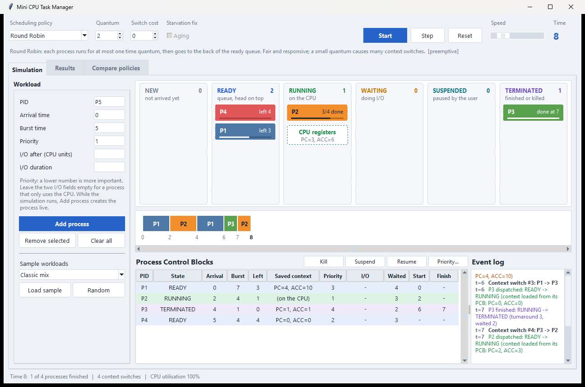
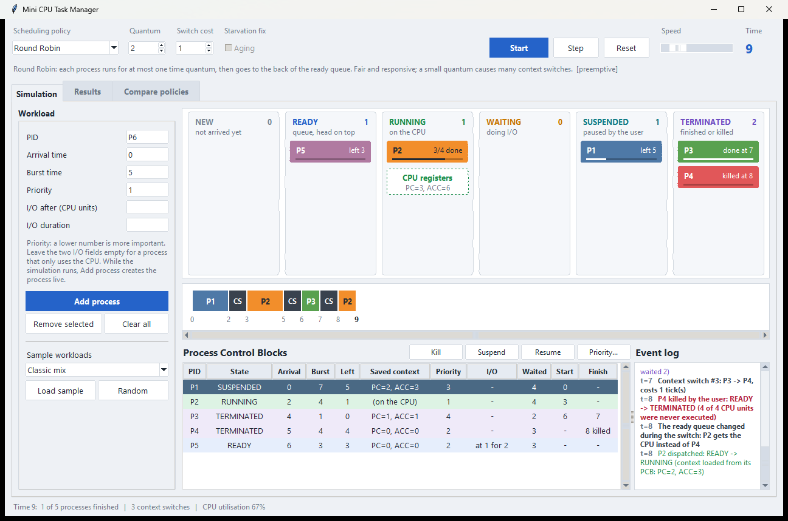

# Mini CPU Task Manager

An educational task manager for the Operating Systems course (group project 1).

It creates **simulated processes** and shows, tick by tick, how a **CPU scheduling policy**
decides which process runs next. The goal is to make process behaviour *visible*:
every process is a coloured card that moves between the process states, while the
Gantt chart, the PCB table and the event log explain what the scheduler just did.

It is also a small **task manager**: while the simulation runs you can create a process,
**kill** it, **suspend** it, **resume** it and change its **priority**, and watch how the
scheduler reacts.



## Run it

**As an application (no Python needed):** double-click `dist/Mini CPU Task Manager.exe` on Windows,
or `Mini CPU Task Manager.app` on macOS. See [Build the application](#build-the-application).

**From the source code:** you need Python 3.10 or newer with tkinter. No other packages are required.
On Windows the command is `python`; on macOS and Linux it is `python3`.

```
python main.py                   # the window
python cli.py --compare          # text mode: compare all policies
python -m unittest -v            # the tests
```

If Python says that tkinter is missing (Ubuntu / Debian):

```
sudo apt install python3-tk
```

Tested with Python 3.12 and Tk 8.6 on Windows 11 and on Linux. The program uses only the standard
library, so it should also run on macOS, but test it on the computer you will use for the demo.

## Build the application

```
python -m pip install pyinstaller
python build_app.py
```

| Run this on | You get |
|---|---|
| Windows | `dist/Mini CPU Task Manager.exe` (one file, about 11 MB) |
| macOS | `dist/Mini CPU Task Manager.app` and a `.zip` of it for sending |

PyInstaller cannot build a Mac application on Windows (or the other way round), so each one is built on
its own system. If nobody in the team has a Mac: open the **Actions** tab of the repository on GitHub and
run **Build the application** (`.github/workflows/build.yml`); it builds both and offers them as downloads.
The Mac application from GitHub is for Apple Silicon Macs (M1 and newer); for an older Intel Mac, run
`python3 build_app.py` on that Mac.

What has been checked: the Windows application was started on a Windows 11 PC. The Mac application was
started by GitHub on a Mac (the build fails if it does not stay open), but nobody has clicked through it
on a Mac yet, so try it before the demo.

The applications are not signed, so the first start shows a warning:
- Windows: "Windows protected your PC" -> **More info** -> **Run anyway**.
- macOS: right-click the application -> **Open** -> **Open**.

## A five-minute tour

1. The window opens with the sample workload **Classic mix**. All four processes are in the **NEW** column.
2. Press **Step** (F6). Time moves one tick: P1 arrives (NEW -> READY) and is dispatched (READY -> RUNNING).
   Read the event log on the right: it says exactly this.
3. Press **Start** (F5) to let the clock run. Change the **Speed** if it is too fast. **Pause** with the same button.
4. Choose another **Scheduling policy**. The simulation starts again from time 0 with the same processes.
5. Choose **Round Robin**, set **Quantum** to 2 and **Switch cost** to 1. The dark **CS** blocks in the
   Gantt chart are context switches: CPU time that no process can use.
6. Load the sample **Starvation and aging**, choose **Priority** and run it. P1 waits until everybody else
   has finished. Turn on **Aging** and run it again: the priority of P1 improves while it waits (`5 -> 1`).
7. Open the **Results** tab for the metrics, and the **Compare policies** tab to run all policies on the
   same workload.
8. Build your own workload with the form on the left: **Add process**, **Remove selected**, **Clear all**, **Random**.
9. Be the task manager: run a few ticks, click a row in the PCB table and press **Suspend**. The card moves to
   SUSPENDED and the scheduler ignores it. Press **Resume**, **Kill** or **Priority...** (a right-click on the row
   shows the same actions). **Add process** now creates a process live, without going back to time 0.
   **Reset** replays the workload from time 0 with every process alive again.



## Where to see each OS concept

| Concept | In the window | In the code |
|---|---|---|
| Process | one coloured card and one row of the PCB table | `core/pcb.py` |
| Process states | the columns NEW, READY, RUNNING, WAITING, SUSPENDED, TERMINATED; the card moves when the state changes | constants in `core/pcb.py`, transitions in `core/engine.py` |
| Process control block (PCB) | the PCB table: PID, state, saved context (PC and ACC), priority, accounting | class `PCB` in `core/pcb.py` |
| CPU burst | columns Burst and Left; the progress bar on every card | `PCB.burst`, `PCB.remaining`, `PCB.next_burst` |
| Arrival time | NEW cards say "arrives at 4"; the event "P3 arrived: NEW -> READY" | `Simulator._admit_arrivals` |
| Priority | column Priority; READY cards show "prio 2"; aging shows `4 -> 2` | `policies/priority*.py`, `Simulator._age` |
| Context switch | event "Context switch #3: P1 -> P3"; "context saved in its PCB: PC=2, ACC=3" and "context loaded from its PCB"; the **CPU registers** box under the running card; the CS blocks; the counter in the status bar | `Simulator._schedule`, `_save_context`, `_dispatch` |
| Managing a process | the buttons Kill, Suspend, Resume, Priority... above the PCB table; Add process during a run | `Simulator.create`, `kill`, `suspend`, `resume`, `set_priority` |
| Scheduling metrics | Results tab and Compare tab | `core/metrics.py` |
| Ready queue | the READY column is in real queue order (head on top) | `Simulator.ready` |
| Preemption | event "P1 preempted: RUNNING -> READY" | `Simulator._schedule` |
| I/O wait | the WAITING column, "I/O: 2 left" | `Simulator._leave_cpu`, `Simulator._finish_io` |
| Starvation and aging | sample "Starvation and aging" with the Aging checkbox | `Simulator._age` |
| Convoy effect | sample "Convoy effect": FCFS, then SJF | `policies/fcfs.py`, `policies/sjf.py` |

## Project structure

```
mini_task_manager/
├── main.py                  starts the window
├── build_app.py             builds the double-click application (.exe / .app)
├── cli.py                   text mode (no window)
├── core/                    the simulator: no interface code here
│   ├── pcb.py               the Process Control Block and the process states
│   ├── engine.py            the clock, the five phases of one tick, and the task-manager operations
│   ├── metrics.py           turnaround, waiting, response, throughput, CPU utilisation
│   └── samples.py           ready-made workloads
├── policies/                one small file per scheduling policy
│   ├── __init__.py          the list of policies and the "contract" they follow
│   ├── fcfs.py  sjf.py  srtf.py
│   ├── priority.py  priority_preemptive.py
│   └── rr.py
├── gui/                     the window (tkinter)
│   ├── app.py               the main window: connects the panels to the simulator
│   ├── controls.py          policy, quantum, switch cost, aging, Start / Step / Reset, speed
│   ├── process_form.py      the workload form
│   ├── state_board.py       the state columns with moving cards, and the CPU registers
│   ├── gantt.py             the live Gantt chart
│   ├── pcb_table.py         the PCB table and the event log
│   ├── results.py           the Results tab
│   ├── compare.py           the Compare policies tab
│   └── theme.py             colours, fonts, widget styles
├── tests/
│   ├── test_engine.py       answers checked against hand-made Gantt charts + rules that must always hold
│   ├── test_manage.py       kill / suspend / resume / priority / create, and the saved CPU context
│   └── test_gui.py          opens the window and presses the buttons (skipped without a display)
├── assets/                  the application icon (drawn by tools/make_icon.py)
└── docs/
    ├── TEAM_ROLES.md        who owns which part (8 members)
    ├── REPORT_TEMPLATE.md   outline of the technical report, with results from the program
    └── screenshots/
```

The important design idea: **`core/` and `policies/` do not know that a window exists.**
The window only calls `Simulator.step()` and then draws what the simulator says.
This is why the same simulator also works in text mode (`cli.py`) and in the tests.

## How the simulator works

Time is counted in whole **ticks**. One call of `Simulator.step()` simulates one tick, the interval
`[time, time + 1)`, in five phases:

| Phase | What happens | State change | Function |
|---|---|---|---|
| 1 | processes that arrive now are admitted | NEW -> READY | `_admit_arrivals` |
| 2 | processes whose I/O is complete come back | WAITING -> READY | `_finish_io` |
| 3 | the policy chooses who gets the CPU; a context switch may happen | READY -> RUNNING, RUNNING -> READY (preemption) | `_schedule`, `_dispatch` |
| 4 | the CPU executes one unit; READY processes wait; I/O makes progress | - | `_run_one_tick` |
| 5 | the running process leaves the CPU if it has finished or needs I/O | RUNNING -> TERMINATED, RUNNING -> WAITING | `_leave_cpu` |

The engine never decides **who** runs next. In phase 3 it always asks the policy:

```python
chosen = self.policy.choose_next(self.ready, self.running, self)
```

### The rules we chose

Different textbooks use slightly different conventions. These are ours; say them in the report and the demo.

- A **lower** priority number means a **more important** process.
- Ties: SJF, SRTF and Priority choose the process that **arrived earlier**. A tie never preempts the running process.
- A process that arrives at time *t* enters the ready queue **before** a process that is preempted at time *t*.
- We count a **context switch** each time the CPU passes from one process to a *different* process.
  The first dispatch, and a dispatch after an idle CPU, are not counted.
- **Switch cost** = number of ticks one context switch takes. During these ticks no process runs (CS in the Gantt chart).
- **Waiting time** = number of ticks a process spends in the READY queue. For a process without I/O this equals
  turnaround - burst.
- **I/O**: a process can have one I/O operation. After `io_at` units of CPU time it moves to WAITING for `io_time`
  ticks. Every process has its own device, so there is no I/O queue.
- **Aging**: every 3 ticks a process waits in the READY queue, its effective priority improves by 1
  (`AGING_INTERVAL` in `core/engine.py`). Aging only works with the two Priority policies.
- **Round Robin**: if the quantum ends and nobody else is ready, the process simply gets a new quantum.
- **CPU burst**: the Burst column is the *total* CPU time of the process. A process with I/O therefore has two
  CPU bursts, one before and one after the I/O. SJF and SRTF compare the **next CPU burst** (`PCB.next_burst`),
  as in the textbook. For a process without I/O this is simply the CPU time it has left.
- **A context switch that costs time**: when the switch is over, the policy is asked again. If a better process
  arrived during the switch, it gets the CPU, and no second switch is paid.

### The context switch is real

The simulated CPU has two registers: **PC** (how many units the running process has executed) and **ACC**
(every unit adds the new PC to it, so after *n* units ACC = 1 + 2 + ... + *n*). There is only one CPU, so:

- when a process leaves the CPU, `_save_context` copies the registers **into its PCB**;
- when a process gets the CPU, `_dispatch` copies them **back from its PCB**.

If either copy is removed, a process continues with the registers of another process and its final ACC is wrong.
`tests/test_manage.py` checks exactly this, so the tests fail without a correct save and restore.

### The rules for managing a live process

- **Kill** works in every state. The process moves to TERMINATED and is marked "killed". Killed processes are
  **not counted** in the average turnaround, waiting and response times, because they never completed.
- **Suspend** works for a READY, RUNNING or WAITING process (not for a NEW one: it has not arrived).
  A suspended process keeps its PCB but cannot get the CPU. If it was doing I/O, the I/O is paused too.
- **Resume** puts the process at the **tail** of the ready queue (or back to its unfinished I/O).
- **Priority...** sets a new base priority. A preemptive priority policy reacts at the next tick.
- **Add process** during a run creates the process live. It cannot arrive in the past: an earlier arrival
  time becomes "now".
- With suspension, the accounting rule is: `turnaround = burst + I/O time + waiting + suspended time`.
- If **only suspended processes** are left, nothing can run: the clock stops and the status bar says why.
- Kill, Suspend, Resume and Priority change only the current run. **Reset** starts again with the original workload.

## Add your own policy

A policy is one small module. Create `policies/ljf.py`:

```python
"""Longest Job First (LJF), non-preemptive. A deliberately bad policy, useful for comparison."""

NAME = "LJF"
SHORT = "LJF"
PREEMPTIVE = False
USES_QUANTUM = False
USES_PRIORITY = False
DESCRIPTION = "Longest Job First: when the CPU becomes free, the ready process with the MOST CPU time left goes next."


def choose_next(ready, running, sim):
    if running is not None:
        return running          # non-preemptive
    if ready:
        return max(ready, key=lambda p: (p.remaining, -p.arrival))
    return None
```

Then add it to the list in `policies/__init__.py`:

```python
from policies import fcfs, sjf, srtf, priority, priority_preemptive, rr, ljf

ALL = [fcfs, sjf, srtf, priority, priority_preemptive, rr, ljf]
```

Nothing else changes: the new policy appears in the window, in text mode and in the Compare tab.

`choose_next(ready, running, sim)` must return `running` (continue), one process from `ready`, or `None` (idle).
It must not change any process: it only chooses.

## Tests

```
python3 -m unittest -v
```

- **Known answers**: FCFS, SJF, SRTF, Round Robin and both Priority policies are compared with Gantt charts
  worked out by hand (average turnaround, waiting and response time).
- **Special situations**: I/O, context-switch cost, aging, a fresh quantum in Round Robin, invalid input.
- **The task manager**: kill, suspend, resume, change priority and create, in every state, also in the middle
  of a context switch; and the saved CPU context (see "The context switch is real").
- **Rules that always hold**: 300 random workloads are run with every policy, and for each process
  `turnaround = burst + I/O time + waiting` must be true, the CPU must execute exactly the total burst time, and so on.
  300 more runs do the same while a "user" kills, suspends, resumes and creates processes at random moments.
- **The window**: `tests/test_gui.py` opens the real window, runs every policy on every sample and presses the main
  buttons. These tests are skipped when the computer has no display.

## A demo plan (about 5 minutes)

1. **Process states and the PCB**: Classic mix, FCFS, press Step eight times. Point at a card moving
   NEW -> READY -> RUNNING -> TERMINATED and at the same row in the PCB table.
2. **Preemption and context switches**: Round Robin, quantum 2, switch cost 1. Show "context saved in its PCB" and
   "context loaded from its PCB" in the event log, the CPU registers box, the Saved context column and the CS blocks. Change the quantum to 1 and to 8 and compare the number of context switches.
3. **I/O**: sample "I/O-bound and CPU-bound". Show RUNNING -> WAITING -> READY.
4. **Starvation and aging**: sample "Starvation and aging", Priority, first without and then with Aging.
5. **Metrics**: sample "Convoy effect", Compare tab. FCFS has an average waiting time of 10.50, SJF only 2.25.
6. **Task manager**: Classic mix, Priority (preemptive), a few steps. Suspend the running process, resume it,
   give a waiting process priority 0 and watch it take the CPU, kill one, add a new one live.

## Limits and ideas

The simulator has one CPU, one I/O operation per process and no memory management.
Ideas for extensions are listed for every team member in [docs/TEAM_ROLES.md](docs/TEAM_ROLES.md).
